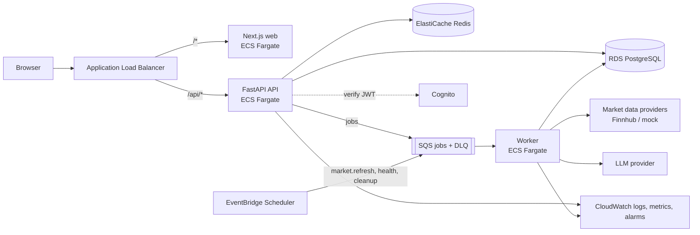

# Knoww: Know what matters

**Knoww is a market watchlist that decides what deserves your attention.**
It remembers what you saw when you last checked. It works out what has *meaningfully*
changed since then, compares each move with the stock's sector and the whole market,
explains why it matters, and stays quiet when nothing does.

> NVIDIA −4.8% since you last checked. Technology −0.7%, market −0.3%, volume 2.8× normal → **HIGH attention, stock-specific.**
> The same −4.8% on a day the market fell 3.9% → **LOW attention, broad market movement.**

That distinction is the product.

---

## Contents

- [The problem](#the-problem) · [The solution](#the-solution) · [Demo](#demo-in-two-minutes)
- [Architecture](#architecture) · [Tech stack](#tech-stack) · [Meaningful-change engine](#the-meaningful-change-engine)
- [Data reliability](#data-reliability) · [AI architecture](#ai-architecture)
- [Run locally](#run-locally) · [Deploy to AWS](#deploy-to-aws) · [Testing](#testing)
- [Limitations](#limitations) · [Tradeoffs](#tradeoffs) · [Further docs](#further-docs)

## The problem

Watchlists show *what moved*. They don't show *what matters*. A stock down 4% looks
alarming until you notice its whole sector is down 4% too. A 2.9% gain in a
low-volatility stock can matter more than a 5% gain in a volatile one. Users get 20
red and green numbers and have to do the triage themselves, every time they look.

Daily change is also the wrong frame. If you checked at 10:32 and it's now 14:46,
what you need is **the change since you last checked**, not since yesterday's close.

## The solution

Knoww is a prioritisation layer on top of a watchlist:

| Question | How Knoww answers it |
|---|---|
| What changed since I last looked? | Per-user **checkpoints** store the price you saw, *and* sector/market benchmark prices at that moment |
| Is it meaningful? | A deterministic, transparent **signal score (0–100)** built from five factors |
| Is it the stock, its sector, or the market? | Same-window comparison against a sector ETF and the S&P 500 (SPY) |
| Why does it matter? | Deterministic facts → an **AI explanation** that may not add facts (fallback text if AI is unavailable) |
| What first? | HIGH / MEDIUM / LOW attention, personalised by sensitivity and preferences |
| Can I trust the data? | Every price carries **freshness** (LIVE, FRESH, DELAYED, STALE) and a **conflict** status; confidence drops visibly |

Knoww never says buy or sell. It tells you what deserves investigation.

## Demo in two minutes

1. Start the app ([Run locally](#run-locally)) and **sign up**.
2. **Onboarding**: keep the suggested stocks (NVDA, AAPL, MSFT, AMZN, TSLA, XOM), choose *Balanced*, then *Start monitoring*.
3. The Command Center says **"You're all caught up."** Knoww has recorded what you saw.
4. Click **Demo market** in the top bar to change the simulated market while you're away:

| Scenario | What you should see |
|---|---|
| Stock-specific drop | NVDA **HIGH** (−4.8% since check vs −4.1% today; sector −0.7%, market −0.3%, 2.8× volume) |
| Broad market decline | Big red numbers everywhere, **nothing** asks for attention: "The market is down 3.9%…" |
| Sector decline | XOM **MEDIUM**, labelled *Energy sector movement* |
| Stock-specific surge | TSLA HIGH, AAPL MEDIUM |
| Volume spike | MSFT on 3.4× volume with a +1.1% move stays LOW. Volume alone isn't enough (switch Settings → Sensitivity *High* and it becomes MEDIUM) |
| Event-driven | AMZN HIGH with the earnings event as a scoring factor |
| Stale data | Prices marked **STALE**, confidence reduced, attention capped at MEDIUM |
| Conflicting providers | NVDA **CONFLICTED**: both provider prices are shown with the resolution reason |
| Provider failure | Primary feed down → delayed fallback feed; System health shows **Degraded** |
| AI failure | Explanations fall back to deterministic text built from the same facts |

5. Open a change with **See why**. You get the explanation, a stock/sector/market comparison and a point-by-point score breakdown. **Mark as reviewed** and the change is no longer treated as new. It comes back only if the stock moves materially further.
6. Click **I'm caught up** to set a new checkpoint. Everything is measured from now.

The simulated market is deterministic and clearly labelled *simulated* everywhere it appears.

## Architecture



The backend is a **modular monolith**: one deployable FastAPI codebase with clear
modules, run as two process types (API and worker). The core loop:

```
MARKET DATA → INGEST → VALIDATE → NORMALIZE → RESOLVE CONFLICTS → STORE CURRENT STATE
→ COMPARE WITH USER CHECKPOINT → SCORE → MARKET/SECTOR CONTEXT → PERSONALISE → PRIORITISE
→ EXPLAIN (AI, async) → SURFACE → USER REVIEWS → CHECKPOINT UPDATED
```

Details: [docs/ARCHITECTURE.md](docs/ARCHITECTURE.md).

## Tech stack

| Layer | Choice |
|---|---|
| Frontend | Next.js 16 (App Router), React 19, TypeScript, Tailwind CSS v4, shadcn/ui-style components (Radix), TanStack Query, Zod, Recharts |
| Backend | Python 3.13, FastAPI, Pydantic v2, SQLAlchemy 2, Alembic |
| Data | PostgreSQL (source of truth), Redis (cache, rate limits, locks: optional with graceful fallback) |
| Async | Amazon SQS (+ DLQ), EventBridge Scheduler, Python workers; ElasticMQ locally |
| Auth | Amazon Cognito (production) / local JWT (development), httpOnly cookies |
| Infra | Docker, Terraform, ECS Fargate, ECR, ALB, RDS, ElastiCache, S3, Secrets Manager, CloudWatch |
| Quality | Pytest, Playwright, GitHub Actions |

## The meaningful-change engine

A pure, deterministic function. The points from each factor add up to the score:

| Factor | Max | Measures |
|---|---:|---|
| Price movement | 30 | Move since checkpoint in units of the stock's own daily volatility, **dampened when the market explains it** |
| Relative performance | 30 | Excess move vs sector (full weight) or vs market (half weight) |
| Volume anomaly | 20 | Session-adjusted volume ÷ 20-day average; halved if the price barely moved |
| Event significance | 15 | Earnings, guidance, news in the window (only real events from the data) |
| Watchlist priority | 5 | Stocks you starred |

Sensitivity sets the thresholds (Balanced: HIGH ≥ 65, MEDIUM ≥ 40). Guardrails:
HIGH needs real price evidence, and stale or conflicting data caps attention at
MEDIUM. Disabled preference factors give their weight to the others, so scores
stay on a 0–100 scale. Every evaluation is stored with its inputs and per-factor
points. Full reasoning and worked examples: [docs/MEANINGFUL_CHANGE_ENGINE.md](docs/MEANINGFUL_CHANGE_ENGINE.md).

## Data reliability

- **Validation**: non-positive or non-finite prices, timestamps in the future, observations older than 10 days and implausible jumps are rejected and logged.
- **Freshness** is computed at read time relative to the market session. A quote from Friday's close is *fresh* on Saturday, not stale. Stale data is never shown as live.
- **Conflicts**: with several providers, Knoww picks a preferred value by reliability × freshness. If prices disagree beyond tolerance (1% by default), the conflict is stored, shown with both values, and confidence is reduced.
- **Missing data stays missing**: no volume → "Volume unavailable"; no history → no chart; no events → "No company event in the data".
- **Failures**: provider retry with backoff → next provider → last-known state, labelled. Redis down → in-process fallback. AI down → deterministic explanation. Database down → controlled 503.
- **Idempotency**: raw quotes are keyed by provider + symbol + timestamp + price; snapshots are written only when state changes; signal scores and change events have deterministic keys; queue jobs have an idempotency ledger. Replaying ingestion never duplicates a change.

## AI architecture

AI is an **explanation layer, never the source of truth**. The backend computes every
number. The model receives only those facts and returns structured JSON. Knoww then:

1. validates the JSON against a Pydantic schema,
2. checks that every number in the text appears in the facts, that attention and confidence match, and that there is no advice language,
3. retries once with the rejection reason,
4. otherwise uses a deterministic explanation built from the same facts.

Explanations are generated **asynchronously** (queue job). The UI shows the deterministic
version immediately and swaps in the AI text when it's ready. The provider sits behind an
interface (`app/providers/ai`), and an Anthropic Messages API adapter is included. With no key
configured, Knoww runs fully on deterministic explanations.

## Run locally

### Option A: Docker (production-shaped)

```bash
docker compose up --build
# web: http://localhost:3000   API docs: http://localhost:8000/api/docs
```

This runs Postgres, Redis, ElasticMQ (SQS-compatible), the API (migrations run on start),
the worker (with the local scheduler) and the web app.

### Option B: without Docker

Requirements: Python 3.12+, Node 22+, PostgreSQL 15+.

```bash
# Backend
cd backend
python -m venv .venv && .venv/Scripts/activate      # macOS/Linux: source .venv/bin/activate
python -m pip install -r requirements-dev.txt
cp ../.env.example .env                              # set DATABASE_URL to your Postgres
python -m alembic upgrade head
python -m uvicorn app.main:app --port 8000           # jobs + scheduler run in-process

# Frontend (second terminal)
cd frontend
npm install
npm run dev                                          # http://localhost:3000 (proxies /api to :8000)
```

### Environment variables

See [`.env.example`](.env.example). The ones that matter most:

| Variable | Purpose |
|---|---|
| `DATABASE_URL` | PostgreSQL connection (or `DB_HOST`/`DB_USER`/`DB_PASSWORD`/`DB_NAME` in AWS) |
| `REDIS_URL` | Optional; graceful in-process fallback without it |
| `MARKET_PROVIDERS` | `mock,mock-reference` (deterministic demo) or `finnhub` |
| `FINNHUB_API_KEY` | Real market data |
| `AI_PROVIDER`, `AI_API_KEY`, `AI_MODEL` | Optional AI explanations |
| `AUTH_MODE` + `COGNITO_*` | `local` for development, `cognito` for production |
| `QUEUE_BACKEND`, `SQS_QUEUE_URL` | `inline` locally, `sqs` in AWS |
| `SCHEDULER_MODE` | `local` or `eventbridge` |
| `DEMO_MODE` | Shows the simulated-market controls (mock providers only) |

## Deploy to AWS

```bash
cd infra/terraform
cp terraform.tfvars.example terraform.tfvars      # region, domain, ACM cert, providers
terraform init && terraform apply
# put FINNHUB / AI keys into the "<name>/app" secret in Secrets Manager
# then run the GitHub Actions "Deploy" workflow (build → ECR → migrate → roll out)
```

Step-by-step guide, IAM for GitHub OIDC, and costs: [docs/DEPLOYMENT.md](docs/DEPLOYMENT.md).

## Testing

```bash
cd backend && python -m pytest -q        # engine, data quality, idempotency, failover, AI fallback, authorization
cd frontend && npx playwright test        # sign up → watchlist → market change → see why → acknowledge
```

CI runs both, plus a migration up/down/up against PostgreSQL, a production build and `terraform validate`.

## Limitations

- **Free market data is thin.** Finnhub's free tier has no volume in quotes and no historical candles, so with Finnhub alone volume and volatility factors show as *unavailable* (and confidence is lower) rather than being estimated. The provider abstraction is ready for a paid feed.
- **US equities only.** Sector context uses SPDR sector ETFs and SPY. Exchange holidays aren't modelled (weekends are).
- **Intraday volume baseline** scales the 20-day average by elapsed session time linearly. Real intraday volume is U-shaped.
- **Attention precision** needs user feedback to measure properly. Knoww records proxies today (high-attention reviewed share, time to first look). An explicit "was this useful?" signal is the next step.
- **Notifications are in-app only.** Records are channel-agnostic, so email or push can be added as delivery workers.
- The Cognito path is implemented and configured by Terraform, but was verified only against the local-JWT path in this repository's tests.

## Tradeoffs

Deterministic scoring rather than ML, AI for explanation only, a modular monolith rather than microservices, PostgreSQL as the source of truth, and queues for anything slow. The reasoning is in [docs/TRADEOFFS.md](docs/TRADEOFFS.md).

## Further docs

[ARCHITECTURE](docs/ARCHITECTURE.md) · [MEANINGFUL_CHANGE_ENGINE](docs/MEANINGFUL_CHANGE_ENGINE.md) · [DATABASE](docs/DATABASE.md) · [API](docs/API.md) · [DEPLOYMENT](docs/DEPLOYMENT.md) · [TRADEOFFS](docs/TRADEOFFS.md) · [REFERENCE_ANALYSIS](docs/REFERENCE_ANALYSIS.md)

---

Knoww is a market-awareness tool, not a broker or an advisor. Nothing in it is investment advice.
