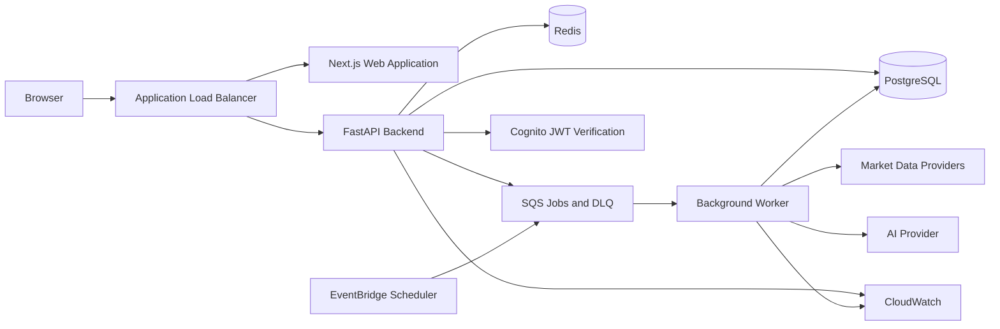

# Knoww — Know What Matters

**A Context-Aware Market Monitoring and Meaningful Change Detection System**

Knoww is an intelligent market watchlist that identifies which stock movements deserve attention. Instead of simply displaying price changes, it evaluates market activity against the user's last-seen checkpoint, sector performance, broader market movements, volatility, trading volume, and relevant events to distinguish meaningful stock-specific changes from ordinary market fluctuations.

It transforms a conventional watchlist into a context-aware market monitoring system that prioritises what matters, explains why it matters, and avoids unnecessary alerts when there is nothing meaningful to report.

> **Example**
>
> NVIDIA declines 4.8% since the user's last check, while the technology sector declines 0.7% and the broader market declines 0.3%, accompanied by 2.8× normal trading volume.
>
> **Result:** HIGH attention — significant stock-specific movement.
>
> If NVIDIA declines by the same 4.8% while the broader market falls 3.9%, the movement receives lower attention because much of the decline is explained by broader market conditions.

This distinction between price movement and meaningful change is the foundation of Knoww.

---

## Table of Contents

- [Problem Statement](#problem-statement)
- [Solution Overview](#solution-overview)
- [Key Features](#key-features)
- [Product Demonstration](#product-demonstration)
- [System Architecture](#system-architecture)
- [Technology Stack](#technology-stack)
- [Meaningful Change Detection Engine](#meaningful-change-detection-engine)
- [Data Reliability and Resilience](#data-reliability-and-resilience)
- [AI Explanation Architecture](#ai-explanation-architecture)
- [Getting Started](#getting-started)
- [Environment Configuration](#environment-configuration)
- [AWS Deployment](#aws-deployment)
- [Testing and Quality Assurance](#testing-and-quality-assurance)
- [Known Limitations](#known-limitations)
- [Engineering Trade-offs](#engineering-trade-offs)
- [Project Documentation](#project-documentation)
- [Disclaimer](#disclaimer)

---

## Problem Statement

Traditional stock watchlists communicate price movements but provide little context about their significance.

A stock declining by 4% may appear concerning until its sector and the broader market are found to have declined by a similar amount. Conversely, a relatively small movement in a low-volatility stock may represent an unusually significant event.

Investors are therefore left to manually interpret multiple indicators every time they revisit their watchlists.

Another limitation is the reliance on daily price changes. When a user checks a stock at 10:32 AM and returns at 2:46 PM, the relevant question is not simply how much the stock has moved since the previous close, but what has changed since the user last reviewed it.

Knoww addresses these limitations by introducing context-aware change detection and personalised attention prioritisation.

## Solution Overview

Knoww operates as an intelligent prioritisation layer over a conventional market watchlist.

It evaluates market activity using user-specific checkpoints and contextual benchmarks to determine whether a movement deserves attention.

| Challenge | Knoww's Approach |
|---|---|
| Identifying changes since the previous visit | Per-user checkpoints store previously observed stock, sector, and market prices. |
| Determining whether a movement is significant | A deterministic signal-scoring engine evaluates multiple independent factors. |
| Separating stock-specific and market-wide movements | Same-window comparisons against sector ETFs and the S&P 500 (SPY). |
| Understanding why a movement matters | Structured explanations generated from validated scoring facts. |
| Prioritising market activity | HIGH, MEDIUM, and LOW attention classifications. |
| Evaluating data reliability | Quote freshness, provider conflicts, and confidence indicators. |
| Avoiding unnecessary alerts | Reviewed changes are acknowledged and only reappear after materially significant further movement. |

Knoww is designed to support informed investigation rather than generate trading instructions.

## Key Features

### 1. Context-Aware Change Detection
- Measures price movements relative to the user's last-seen checkpoint.
- Evaluates stock performance against sector and broader market benchmarks.
- Distinguishes company-specific movements from market-wide fluctuations.
- Considers volatility to avoid treating every percentage change equally.

### 2. Deterministic Attention Scoring
- Calculates a transparent signal score between 0 and 100.
- Evaluates price movement, relative performance, volume anomalies, events, and watchlist priority.
- Supports configurable sensitivity preferences.
- Provides factor-level scoring breakdowns for explainability.

### 3. Personalised Market Checkpoints
- Maintains individual observation checkpoints for each user.
- Records the relevant stock, sector, and market benchmark prices.
- Supports explicit checkpoint updates through the catch-up workflow.
- Prevents previously reviewed movements from repeatedly appearing as new changes.

### 4. Market and Sector Context
- Uses SPDR sector ETFs to establish sector-level benchmarks.
- Uses SPY to represent broader S&P 500 market performance.
- Evaluates movements over equivalent observation windows.
- Identifies whether an individual stock is outperforming or underperforming its surrounding market.

### 5. AI-Assisted Explanations
- Generates structured explanations using deterministic market facts.
- Validates AI-generated output against predefined schemas.
- Prevents unsupported numerical claims and investment-advice language.
- Falls back to deterministic explanations when the AI provider is unavailable.

### 6. Data Quality and Reliability
- Tracks quote freshness and provider conflicts.
- Rejects invalid or implausible market observations.
- Supports provider failover and last-known-state handling.
- Reduces confidence when data reliability is compromised.
- Preserves missing data rather than fabricating values.

### 7. Interactive Market Simulation
- Includes deterministic simulated-market scenarios.
- Demonstrates stock-specific movements, market declines, sector movements, volume spikes, earnings events, and provider failures.
- Makes it possible to evaluate system behaviour without depending entirely on live market conditions.

---

## Product Demonstration

Knoww includes a deterministic market simulation environment for demonstrating its core detection and prioritisation capabilities.

### Supported Scenarios

| Scenario | Expected Behaviour |
|---|---|
| Stock-specific decline | NVDA receives HIGH attention due to significant relative underperformance. |
| Broad market decline | Market-wide movements are contextualised without generating unnecessary high-priority alerts. |
| Sector decline | XOM receives MEDIUM attention with an Energy sector movement classification. |
| Stock-specific surge | TSLA receives HIGH attention and AAPL receives MEDIUM attention. |
| Volume anomaly | MSFT's 3.4× volume with a relatively small price movement remains LOW under Balanced sensitivity. |
| Event-driven movement | AMZN receives HIGH attention with earnings incorporated into the scoring factors. |
| Stale market data | Prices are labelled STALE, confidence is reduced, and attention is capped at MEDIUM. |
| Conflicting providers | NVDA displays conflicting provider values alongside the resolution explanation. |
| Provider failure | The primary market feed fails over to an available fallback provider. |
| AI failure | Explanations fall back to deterministic text generated from validated facts. |

### Running the Demonstration

1. Start the application and create an account.
2. Complete onboarding using the suggested watchlist: NVDA, AAPL, MSFT, AMZN, TSLA, and XOM.
3. Select Balanced sensitivity and start monitoring.
4. The Command Center initially indicates that the user is caught up.
5. Select **Demo Market** to introduce a simulated market scenario.
6. Open a detected change using **See why** to inspect its explanation and scoring breakdown.
7. Select **Mark as reviewed** to acknowledge the change.
8. Select **I'm caught up** to establish a new observation checkpoint.

All simulated market activity is explicitly labelled as simulated.

---

## System Architecture

Knoww follows a modular monolith architecture, separating application responsibilities while maintaining a shared backend codebase.

The API and background worker operate as independent process types, allowing asynchronous workloads to be scaled separately.

### Architecture Overview



### Core Processing Pipeline

```text
MARKET DATA INGESTION
        |
        v
VALIDATION AND NORMALISATION
        |
        v
PROVIDER CONFLICT RESOLUTION
        |
        v
CURRENT MARKET STATE
        |
        v
USER CHECKPOINT COMPARISON
        |
        v
MEANINGFUL CHANGE SCORING
        |
        v
SECTOR AND MARKET CONTEXT
        |
        v
PERSONALISED PRIORITISATION
        |
        v
EXPLANATION GENERATION
        |
        v
CHANGE SURFACING
        |
        v
USER REVIEW AND ACKNOWLEDGEMENT
        |
        v
CHECKPOINT UPDATE
```

### Backend Design

The backend is organised around distinct application responsibilities:

- Market data ingestion and provider integration.
- Quote validation, normalisation, and conflict resolution.
- Checkpoint management and market comparison.
- Deterministic signal scoring and prioritisation.
- AI explanation generation and validation.
- Authentication, authorisation, and user preferences.
- Queue processing and scheduled background operations.

PostgreSQL acts as the primary source of truth, while Redis provides caching, rate limiting, and distributed coordination when available.

Detailed architecture documentation is available in [`docs/ARCHITECTURE.md`](docs/ARCHITECTURE.md).

---

## Technology Stack

| Layer | Technologies |
|---|---|
| Frontend | Next.js 16, React 19, TypeScript |
| Styling | Tailwind CSS v4, Radix UI, shadcn/ui-style components |
| Frontend Data | TanStack Query, Zod, Recharts |
| Backend | Python 3.13, FastAPI, Pydantic v2 |
| ORM and Migrations | SQLAlchemy 2, Alembic |
| Database | PostgreSQL |
| Caching | Redis |
| Asynchronous Processing | Amazon SQS, Dead-Letter Queues, Python Workers |
| Local Queue Infrastructure | ElasticMQ |
| Authentication | Amazon Cognito, local JWT authentication |
| Market Data | Finnhub, deterministic mock providers |
| AI Integration | Provider abstraction, Anthropic Messages API adapter |
| Cloud Infrastructure | AWS ECS Fargate, ECR, ALB, RDS, ElastiCache |
| Infrastructure as Code | Terraform |
| Storage and Secrets | Amazon S3, AWS Secrets Manager |
| Monitoring | Amazon CloudWatch |
| Containerisation | Docker, Docker Compose |
| Testing | Pytest, Playwright |
| CI/CD | GitHub Actions |

---

## Meaningful Change Detection Engine

The core of Knoww is a deterministic scoring engine that evaluates whether a market movement is significant enough to deserve attention.

Rather than relying exclusively on absolute percentage changes, it combines multiple contextual factors into a single score ranging from 0 to 100.

### Scoring Model

| Factor | Maximum Points | Evaluation |
|---|---:|---|
| Price Movement | 30 | Measures movement since the user's checkpoint relative to the stock's historical daily volatility, with market-explained movements dampened. |
| Relative Performance | 30 | Measures excess movement against the relevant sector or broader market benchmark. |
| Volume Anomaly | 20 | Evaluates trading volume against its 20-day average, with reduced contribution when price movement is insignificant. |
| Event Significance | 15 | Incorporates relevant earnings, guidance, and news events available in the data. |
| Watchlist Priority | 5 | Gives additional priority to user-starred stocks. |
| **Total** | **100** | |

### Attention Classification

Under Balanced sensitivity:

| Classification | Score |
|---|---:|
| HIGH | 65 and above |
| MEDIUM | 40–64 |
| LOW | Below 40 |

Sensitivity preferences modify the classification thresholds.

### Scoring Guardrails

- HIGH attention requires meaningful price-movement evidence.
- Stale or conflicting data caps attention at MEDIUM.
- Missing data is not replaced with fabricated estimates.
- Volume alone cannot generate a high-priority signal.
- Disabled preference factors have their weights redistributed to enabled factors to preserve the 0–100 scoring scale.
- Every evaluation retains its inputs and individual factor contributions.

This approach makes the scoring process deterministic, reproducible, and auditable.

For detailed formulas and worked examples, see [`docs/MEANINGFUL_CHANGE_ENGINE.md`](docs/MEANINGFUL_CHANGE_ENGINE.md).

---

## Data Reliability and Resilience

Market data reliability is treated as a core system responsibility rather than an implementation detail.

### Data Validation
- Rejects non-positive and non-finite prices.
- Rejects observations with future timestamps.
- Rejects observations older than the configured ten-day validation window.
- Identifies and rejects implausible price jumps.
- Records rejected observations for operational visibility.

### Quote Freshness

Every quote is assigned a freshness classification:

| Status | Meaning |
|---|---|
| LIVE | Current market observation. |
| FRESH | Recently observed data within the applicable session rules. |
| DELAYED | Data that is available but not real-time. |
| STALE | Data outside the acceptable freshness window. |

Freshness is evaluated relative to the market session. For example, Friday's closing quote can remain fresh on Saturday.

### Provider Conflict Resolution

When multiple providers return different prices:

1. Provider reliability and observation freshness are evaluated.
2. A preferred value is selected using reliability and freshness.
3. Material differences beyond the configured tolerance are recorded as conflicts.
4. Both provider values and the resolution reason remain available.
5. Confidence is reduced when conflicting observations are detected.

The default conflict tolerance is 1%.

### Failure Handling

| Failure | Recovery Strategy |
|---|---|
| Primary market provider unavailable | Retry with backoff and attempt the next provider. |
| All market providers unavailable | Retain last-known data with appropriate freshness labels. |
| Redis unavailable | Fall back to in-process mechanisms. |
| AI provider unavailable | Generate deterministic explanations. |
| Database unavailable | Return a controlled service-unavailable response. |
| Queue job retried | Use idempotency controls to prevent duplicate processing. |

### Idempotent Processing

The ingestion and processing pipeline incorporates deterministic keys and idempotency controls.

- Raw quotes are identified using provider, symbol, timestamp, and price.
- Snapshots are written only when the underlying state changes.
- Signal evaluations and change events use deterministic identifiers.
- Queue jobs use an idempotency ledger.

These controls help prevent duplicate changes during retries and ingestion replays.

---

## AI Explanation Architecture

AI in Knoww is an explanation layer, not a decision-making engine.

All numerical calculations, signal scores, market comparisons, and attention classifications are produced by deterministic backend logic.

The AI provider receives validated market facts and generates structured explanatory output.

### Explanation Validation Pipeline

1. The backend computes the market facts and signal score.
2. An asynchronous queue job requests an AI-generated explanation.
3. The returned JSON is validated against a Pydantic schema.
4. Numerical claims are checked against the supplied facts.
5. Attention and confidence classifications are verified.
6. Unsupported investment-advice language is rejected.
7. Invalid responses are retried once with the validation failure reason.
8. If validation still fails or the provider is unavailable, deterministic fallback text is used.

The frontend displays the deterministic explanation immediately and replaces it with the AI-generated version when available.

The provider integration is abstracted behind `app/providers/ai`, allowing additional providers to be integrated without changing the core scoring engine.

An Anthropic Messages API adapter is included. AI functionality is optional; the application can operate using deterministic explanations without an API key.

---

## Getting Started

Knoww supports both Docker-based execution and local development without Docker.

### Prerequisites

| Requirement | Version |
|---|---|
| Python | 3.12+ |
| Node.js | 22+ |
| PostgreSQL | 15+ |
| Docker | Recommended for containerised execution |

### Option 1: Docker (Recommended)

Clone the repository:

```bash
git clone https://github.com/sritejaswini15/Context-Aware-Meaningful-Market-Change-Detection-System.git

cd Context-Aware-Meaningful-Market-Change-Detection-System
```

Start the application:

```bash
docker compose up --build
```

The Docker environment starts:

- PostgreSQL database.
- Redis.
- ElasticMQ (SQS-compatible local queue).
- FastAPI backend.
- Background worker.
- Next.js frontend.
- Local scheduler.

Application endpoints:

| Service | URL |
|---|---|
| Frontend | http://localhost:3000 |
| Backend | http://localhost:8000 |
| API Documentation | http://localhost:8000/api/docs |

### Option 2: Local Development

**1. Clone the repository**

```bash
git clone https://github.com/sritejaswini15/Context-Aware-Meaningful-Market-Change-Detection-System.git

cd Context-Aware-Meaningful-Market-Change-Detection-System
```

**2. Configure the backend**

```bash
cd backend

python -m venv .venv
```

Activate the virtual environment on Windows:

```powershell
.venv\Scripts\Activate.ps1
```

On macOS/Linux:

```bash
source .venv/bin/activate
```

Install dependencies:

```bash
python -m pip install -r requirements-dev.txt
```

Configure environment variables:

```bash
cp ../.env.example .env
```

On Windows PowerShell, use:

```powershell
Copy-Item ../.env.example .env
```

Configure the PostgreSQL connection in `.env`, then run database migrations:

```bash
python -m alembic upgrade head
```

Start the backend:

```bash
python -m uvicorn app.main:app --port 8000
```

**3. Start the frontend**

Open a second terminal:

```bash
cd frontend

npm install

npm run dev
```

The frontend will be available at:

```text
http://localhost:3000
```

The local backend runs background jobs and scheduling in-process.

---

## Environment Configuration

Application configuration is managed through environment variables.

Refer to [`.env.example`](.env.example) for the complete configuration template.

| Variable | Description |
|---|---|
| `DATABASE_URL` | PostgreSQL connection string. |
| `DB_HOST`, `DB_USER`, `DB_PASSWORD`, `DB_NAME` | Alternative database configuration for AWS. |
| `REDIS_URL` | Optional Redis connection. |
| `MARKET_PROVIDERS` | Configures market data providers, such as `mock,mock-reference` or `finnhub`. |
| `FINNHUB_API_KEY` | API key for Finnhub market data integration. |
| `AI_PROVIDER` | Selects the configured AI provider. |
| `AI_API_KEY` | Optional AI provider authentication key. |
| `AI_MODEL` | Configures the AI model. |
| `AUTH_MODE` | Selects local or Cognito authentication. |
| `COGNITO_*` | Amazon Cognito configuration. |
| `QUEUE_BACKEND` | Selects inline or SQS queue processing. |
| `SQS_QUEUE_URL` | SQS queue endpoint. |
| `SCHEDULER_MODE` | Selects local or EventBridge scheduling. |
| `DEMO_MODE` | Enables simulated-market controls when using mock providers. |

Never commit `.env` files, API keys, database credentials, or other secrets to version control.

---

## AWS Deployment

Knoww includes Terraform infrastructure definitions and a GitHub Actions deployment workflow.

The production architecture is designed around AWS-managed infrastructure and independently scalable application processes.

### Infrastructure Components

- Amazon ECS Fargate for web, API, and worker services.
- Amazon ECR for container image storage.
- Application Load Balancer for application routing.
- Amazon RDS for PostgreSQL.
- Amazon ElastiCache for Redis.
- Amazon SQS for asynchronous processing.
- Amazon EventBridge Scheduler for scheduled operations.
- Amazon Cognito for production authentication.
- Amazon S3 for object storage.
- AWS Secrets Manager for sensitive configuration.
- Amazon CloudWatch for monitoring and operational visibility.

### Deployment Steps

Navigate to the Terraform directory:

```bash
cd infra/terraform
```

Create the Terraform variables file:

```bash
cp terraform.tfvars.example terraform.tfvars
```

On Windows PowerShell:

```powershell
Copy-Item terraform.tfvars.example terraform.tfvars
```

Configure the required AWS region, domain, ACM certificate, and provider settings.

Initialise Terraform:

```bash
terraform init
```

Review and apply the infrastructure:

```bash
terraform plan

terraform apply
```

Configure the required market data and AI credentials in AWS Secrets Manager.

Finally, execute the GitHub Actions **Deploy** workflow to build container images, publish them to ECR, run database migrations, and roll out the updated services.

For IAM configuration, GitHub OIDC integration, deployment procedures, and infrastructure costs, refer to [`docs/DEPLOYMENT.md`](docs/DEPLOYMENT.md).

---

## Testing and Quality Assurance

Knoww includes automated backend and frontend testing to validate its primary application workflows and reliability mechanisms.

### Backend Tests

```bash
cd backend

python -m pytest -q
```

Coverage areas include:

- Meaningful-change scoring.
- Data validation and quality.
- Provider failover.
- Idempotent ingestion.
- AI explanation validation and fallback.
- Authentication and authorisation.

### Frontend End-to-End Tests

```bash
cd frontend

npx playwright test
```

The end-to-end workflow covers:

- User registration.
- Watchlist configuration.
- Market movement detection.
- Change explanation.
- User acknowledgement.

### Continuous Integration

GitHub Actions validates:

- Backend automated tests.
- Frontend Playwright tests.
- Database migration up/down/up against PostgreSQL.
- Production frontend builds.
- Terraform configuration validation.

---

## Known Limitations

The following limitations are documented as part of the current implementation.

| Area | Limitation |
|---|---|
| Market Data | Finnhub's free tier does not provide all required volume and historical candle data. Unsupported factors are marked unavailable rather than estimated. |
| Market Coverage | The current implementation focuses on US equities. |
| Sector Context | Sector comparisons use SPDR sector ETFs and SPY. |
| Exchange Calendars | Exchange holidays are not fully modelled; weekends are handled. |
| Intraday Volume | The current baseline scales the 20-day average linearly by elapsed session time rather than modelling the typical U-shaped intraday volume distribution. |
| Attention Precision | Effectiveness requires further user-feedback data and measurement. Current evaluation uses proxies such as reviewed high-attention changes and time to first review. |
| Notifications | Notifications are currently in-app. The underlying records are designed to support additional delivery channels. |
| Cognito Verification | The Cognito integration and Terraform configuration are implemented, but repository tests have verified the local JWT authentication path rather than a complete Cognito deployment. |

These limitations are explicit so that data availability, operational assumptions, and areas requiring further validation remain transparent.

---

## Engineering Trade-offs

Several architectural decisions prioritise transparency, reliability, and maintainability.

| Decision | Rationale |
|---|---|
| Deterministic scoring instead of ML | Ensures reproducible results, transparent factor contributions, and auditable decisions. |
| AI for explanations only | Prevents probabilistic model output from controlling financial calculations or attention classifications. |
| Modular monolith instead of microservices | Reduces operational complexity while preserving clear domain boundaries. |
| PostgreSQL as the source of truth | Provides durable, consistent application state. |
| Asynchronous background processing | Keeps market ingestion, AI generation, and scheduled operations separate from user-facing request handling. |
| Explicit data-quality indicators | Prevents unreliable market observations from being presented with misleading confidence. |
| Provider abstraction | Allows market data and AI integrations to evolve independently of the core application. |

Further architectural reasoning is documented in [`docs/TRADEOFFS.md`](docs/TRADEOFFS.md).

---

## Project Documentation

Additional technical documentation is maintained in the `docs/` directory.

| Document | Description |
|---|---|
| [ARCHITECTURE.md](docs/ARCHITECTURE.md) | System architecture, backend modules, and processing flow. |
| [MEANINGFUL_CHANGE_ENGINE.md](docs/MEANINGFUL_CHANGE_ENGINE.md) | Scoring methodology, formulas, and worked examples. |
| [DATABASE.md](docs/DATABASE.md) | Database schema and data relationships. |
| [API.md](docs/API.md) | Backend API reference. |
| [DEPLOYMENT.md](docs/DEPLOYMENT.md) | AWS infrastructure and deployment guide. |
| [TRADEOFFS.md](docs/TRADEOFFS.md) | Engineering decisions and architectural trade-offs. |
| [REFERENCE_ANALYSIS.md](docs/REFERENCE_ANALYSIS.md) | Reference project analysis and design considerations. |

---

## Disclaimer

Knoww is a market-awareness and information-prioritisation platform. It is not a brokerage platform, investment adviser, or automated trading system.

The application does not provide buy, sell, or hold recommendations. Its purpose is to help users identify and investigate potentially meaningful market movements using contextual data and transparent scoring logic.

Market data availability, freshness, and accuracy depend on the configured data providers.

---

**Knoww — Less noise. More context. Know what matters.**
