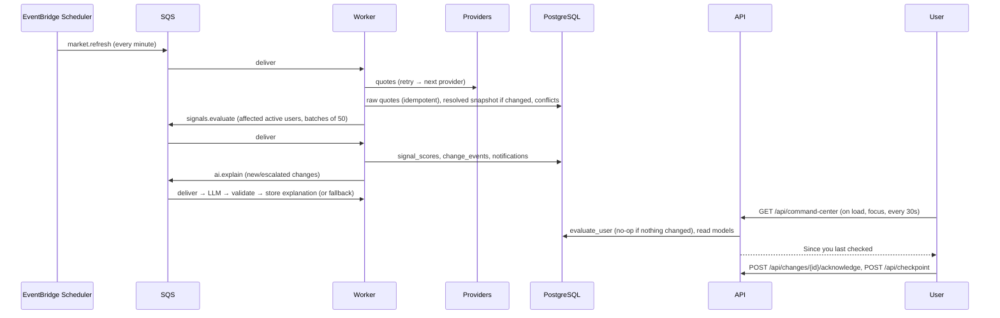

# Architecture

## Shape

A **modular monolith**: one FastAPI codebase, two process types.

| Process | Runs | Scales on |
|---|---|---|
| `api` (uvicorn) | REST API, read-through signal evaluation | CPU / request rate |
| `worker` (`python -m app.workers.main`) | SQS consumer: ingestion, signal fan-out, AI explanations, health, cleanup | Queue depth |
| `web` (Next.js) | UI. `/api/*` goes to the API (ALB rule in AWS, Next.js rewrite locally) | CPU |

Locally, without AWS, `QUEUE_BACKEND=inline` runs jobs on an in-process thread pool and
`SCHEDULER_MODE=local` runs the scheduler inside the API process. The code paths are
identical; only the transport changes.

## Backend modules (`backend/app`)

```
api/routes/        HTTP layer: auth, watchlists, changes, stocks, command-center, market, system, demo
core/              config, db (incl. dialect-aware INSERT … ON CONFLICT DO NOTHING), cache (Redis + fallback), security, errors, logging
models/            SQLAlchemy 2 models
schemas/           Pydantic request/response models (drive OpenAPI)
providers/market/  MarketDataProvider contract, FinnhubProvider, deterministic MockProvider, universe, scenarios
providers/ai/      AIProvider contract, Anthropic adapter, simulated outage
services/
  market_data/     ingestion pipeline, validation, freshness, conflict resolution
  snapshots/       checkpoints and baselines ("what the user last saw")
  signal_engine/   pure scoring engine
  change_detection/ evaluation, change-event lifecycle, read models
  market_context/  market and sector context
  ai/              explanation generation, grounding checks, deterministic fallback
  notifications/   in-app notification records
  system_health/   component health and product metrics
  watchlists/, users/, preferences/, demo/
workers/           queue abstraction, job handlers, worker loop, local scheduler
```

The rest of the application never imports a vendor client: market and AI vendors live only in `providers/`.

## The core loop



**Read-through evaluation.** The worker evaluates users after each ingestion so
notifications are timely. The API also calls `evaluate_user` on reads. It is
deterministic, takes milliseconds per watchlist, and writes nothing if nothing changed.
So a user never sees results that are inconsistent with stored market state, even when
the queue is lagging. Slow work (provider I/O, AI) never runs in a user request,
with one exception: the first quote for a newly added, never-seen symbol, so its
baseline price exists.

## Data model highlights

- `stocks.latest_snapshot_id` is the **current market state**: one indexed join instead of "latest row per symbol" queries.
- `checkpoint_baselines` holds one *current* row per (user, symbol), enforced by a partial unique index, with the sector and market benchmark prices captured at the same moment.
- `signal_scores` is an append-only audit log of evaluations, deduplicated by a hash of the inputs that affect scoring.

See [DATABASE.md](DATABASE.md).

## Reliability and degradation

| Dependency | Failure behaviour |
|---|---|
| Market provider | Retry with backoff → next provider in the chain → last-known snapshot, labelled DELAYED/STALE. Source status is recorded in `data_sources` |
| Conflicting providers | Preferred by reliability × freshness; stored in `data_conflicts`; shown; confidence reduced |
| AI | Retry once with the rejection reason → deterministic explanation. The UI is never blocked |
| Redis | 30s circuit breaker → in-process cache, rate limits and locks |
| SQS | Enqueue happens after commit; failures are logged and never fail the request. Consumer failures are redelivered, then go to the DLQ after 5 attempts (alarm) |
| Database | 503 with a retry message; health checks fail so the ALB stops routing |
| Duplicate messages | `processed_jobs` ledger; deterministic keys on quotes, snapshots, scores, events, notifications |

## Security

- Auth: Cognito (prod) or local JWT (dev). Tokens live in **httpOnly, SameSite** cookies; the browser never handles tokens. Bearer tokens are also accepted for API clients.
- Authorization: every query is scoped by `user_id`. Another user's IDs get **404**, not 403, so existence isn't leaked. Covered by tests.
- Input validation via Pydantic (ticker format, name lengths, enums). Rate limiting per IP for auth and per user for the API (Redis, with in-process fallback).
- Secrets: environment variables only. In AWS, ECS injects them from Secrets Manager (DB password from the RDS-managed secret). No keys in the frontend.
- Security headers on both apps; error responses never include stack traces; CORS is closed by default (same-origin behind the ALB).

## Observability

- Structured JSON logs with request IDs. Domain events (`market.ingested`, `market.provider_failure`, `market.data_conflict`, `signal.generated`, `change.detected`, `ai.generated`, `ai.failure`, `notification.generated`, `change.acknowledged`…) are queryable in CloudWatch Logs Insights.
- Log metric filters turn `market.all_providers_failed` and `ai.failure` into CloudWatch metrics with alarms. Further alarms cover ALB 5xx and p95 latency, the DLQ, and RDS CPU and storage.
- `/system` shows component health, provider status, conflicts and product metrics. Sentry is optional (`SENTRY_DSN`).

## Scaling notes

- Ingestion cost scales with *distinct symbols*, not users. Evaluation fans out in batches of 50 users, and only active users (seen in the last 30 days) are evaluated eagerly. Everyone else is evaluated lazily on their next visit.
- A per-user lock (Redis) serialises evaluation. Market refresh takes a distributed lock so overlapping schedules don't double-ingest.
- Postgres indexes match the access paths: (user, status, state) for changes, (symbol, timestamp) for observations, and partial unique current baselines.
- Retention: raw quotes are pruned after 3 days. Snapshots are kept only on change, so the table grows with *price changes*, not with polling.
