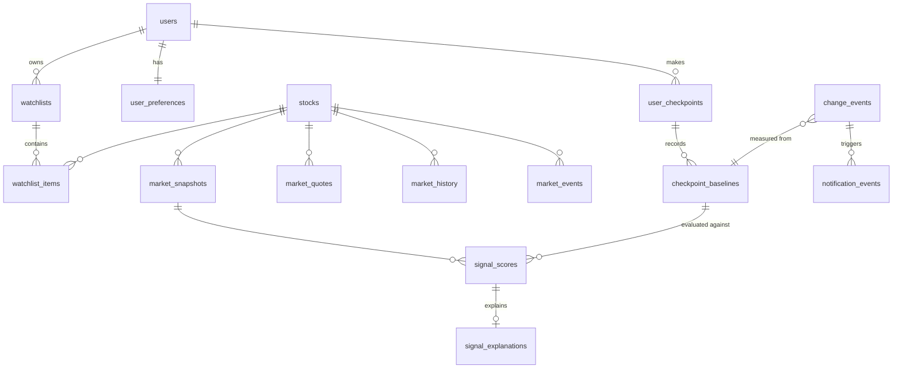

# Database

PostgreSQL is the source of truth. The schema is managed by Alembic (`backend/alembic`).
Tests also run on SQLite: the models use only portable types plus
`with_variant` for JSONB and BIGSERIAL.

```bash
python -m alembic upgrade head      # apply
python -m alembic downgrade base    # roll back (CI checks up → down → up)
```

## Tables

### Users and personalisation
| Table | Purpose | Keys and constraints |
|---|---|---|
| `users` | Account (local or Cognito `external_id`) | unique `email`, unique `external_id`; `last_evaluated_at` invalidated when inputs change |
| `user_preferences` | Sensitivity, factor toggles, notification threshold | PK/FK `user_id` (cascade) |

### Watchlists and memory
| Table | Purpose | Keys and constraints |
|---|---|---|
| `watchlists` | Named lists | FK user (cascade); unique (`user_id`, `name`) |
| `watchlist_items` | Symbols with priority | unique (`watchlist_id`, `symbol`) |
| `user_checkpoints` | "I reviewed this" moments (all or one watchlist) | index (`user_id`, `created_at`) |
| `checkpoint_baselines` | What the user saw per symbol, **plus sector and market prices at that moment** | **partial unique** (`user_id`, `symbol`) `WHERE is_current`; `latest_signal_id` points to the newest evaluation |

### Market data
| Table | Purpose | Keys and constraints |
|---|---|---|
| `stocks` | Reference data, sector benchmark, 20-day volume and volatility; `latest_snapshot_id` = current state | PK `symbol` |
| `data_sources` | Provider registry and health (reliability, failures, last error) | PK `name` |
| `market_quotes` | Raw validated observations per provider | unique `dedupe_key` (provider, symbol, ts, price); index (`symbol`, `market_timestamp`); pruned after 3 days |
| `market_snapshots` | Resolved state after conflict resolution; written **only when state changes** | index (`symbol`, `market_timestamp`) |
| `market_history` | Daily bars | unique (`symbol`, `date`) |
| `market_events` | Earnings, news, dividends… | unique `dedupe_key` (provider event id); index (`symbol`, `event_time`) |
| `data_conflicts` | Provider disagreements with the chosen value and reason | unique per snapshot; index (`symbol`, `detected_at`) |

### Signals
| Table | Purpose | Keys and constraints |
|---|---|---|
| `signal_scores` | Append-only audit of every distinct evaluation: inputs, factor points, caveats, engine version | unique `dedupe_key` (hash of the scoring-relevant inputs + preferences + version) |
| `change_events` | Meaningful changes surfaced to a user; `state` NEW/SEEN/ACKNOWLEDGED, `status` ACTIVE/RESOLVED/SUPERSEDED/ARCHIVED | unique `dedupe_key` (user, symbol, baseline, direction, generation); indexes (`user_id`, `status`, `state`), (`user_id`, `created_at`) |
| `signal_explanations` | AI or fallback explanation per signal score | unique `signal_score_id` |
| `notification_events` | In-app notifications; `channel` column ready for other channels | unique `dedupe_key` (event, kind, attention) |

### Operations
| Table | Purpose |
|---|---|
| `system_health` | Last known status per component |
| `app_state` | Small cross-process state: demo scenario, last ingest, worker heartbeat |
| `processed_jobs` | Idempotency ledger for at-least-once queue delivery |

## Relationships



## Idempotency at a glance

| Operation | Mechanism |
|---|---|
| Re-ingesting the same quote | `market_quotes.dedupe_key` + `ON CONFLICT DO NOTHING` |
| Polling an unchanged market | No new snapshot; `last_confirmed_at` is bumped |
| Re-evaluating unchanged inputs | Same `signal_scores.dedupe_key` → no new row, no new event |
| Duplicate queue delivery | `processed_jobs` ledger for once-only jobs |
| Concurrent evaluation | Per-user lock, unique event keys + savepoint |
